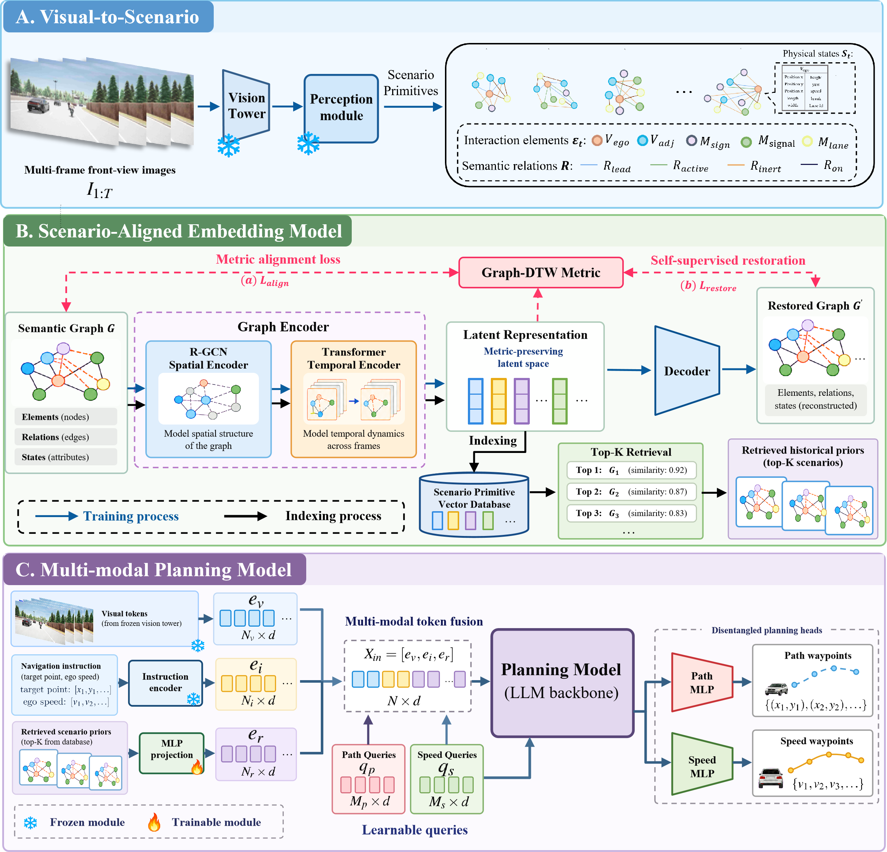
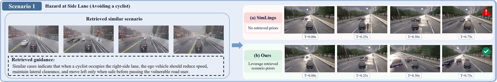
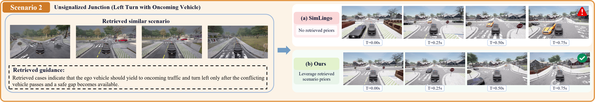

# VLMDriver-RAG: Retrieval-Augmented Vision-Language-Model for Autonomous Driving

**VLMDriver-RAG** is a structure-aware retrieval-augmented framework that uses historical driving scenarios to support path and speed planning.

<p align="center">
  <a href="https://infinidrive.github.io/VLMDriver-RAG/">Project Page</a> •
  <a href="https://github.com/InfiniDrive/VLMDriver-RAG">GitHub</a>
</p>


<p align="center">
  
</p>

## News

- **[2026/05/07]** 🌐 Project page is live: [Project](https://infinidrive.github.io/VLADriver-RAG/).
- **[2026/05/12]** 👉 We released our paper on [arXiv](https://arxiv.org/abs/2605.08133).
- **[2026/11/04]** 🔄 We renamed our model from **VLADriver-RAG** to **VLMDriver-RAG**.

## Visualization

<p align="center">
  
</p>

Historical guidance supports reducing speed, maintaining clearance, and safely passing a cyclist in the Hazard at Side Lane scenario.

<p align="center">
  
</p>

At an Unsignalized Junction, retrieved scenarios guide yielding to oncoming traffic before turning left. Both figures compare (a) SimLingo with (b) VLMDriver-RAG.

## quick start

Coming soon! We will release the code and quick start instructions after the paper is accepted.

## Citation

The following citation refers to the revised manuscript supplied here; the earlier arXiv version is linked above.

```bibtex
@misc{zhao2026vlmdriverrag,
  title={VLMDriver-RAG: Retrieval-Augmented Vision-Language-Model for Autonomous Driving},
  author={Rui Zhao and Haofeng Hu and Zhenhai Gao and Jiaqiao Liu and Fei Gao},
  year={2026},
  note={Revised manuscript},
  url={https://github.com/InfiniDrive/VLMDriver-RAG}
}
```
